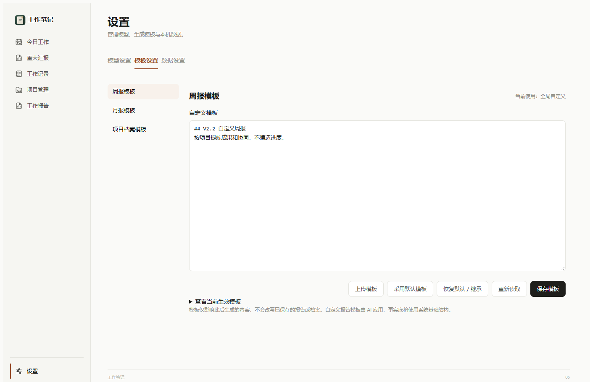
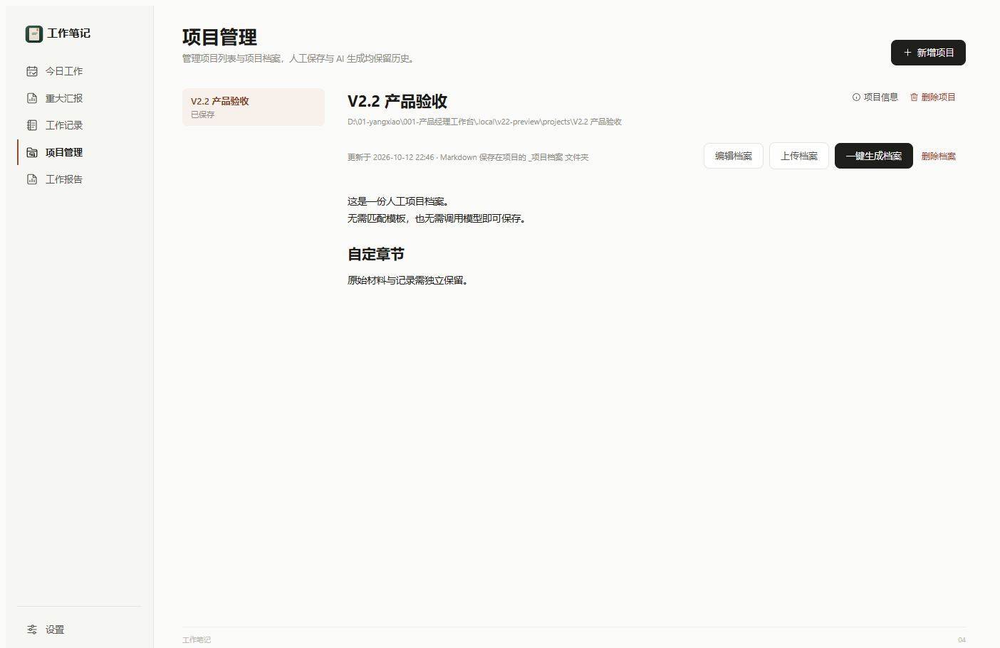

# 工作笔记 V2.2 交付说明

版本：**2.2.0-beta.2**；数据结构版本：4。构建日期：2026-10-12，最终核验及公开整理日期：2026-10-13。

## 下载与设计

- [GitHub 预发布版本](https://github.com/DeshawnYO/work-notes/releases/tag/v2.2.0-beta.2)
- [Windows x64 安装包](https://github.com/DeshawnYO/work-notes/releases/download/v2.2.0-beta.2/Work-Notes-2.2.0-beta.2-Windows-x64.exe)
- [产品设计与验收规则](../../requirements/V2.2/产品设计与验收.md)
- [版本说明与许可](../../../releases/windows/2.2.0-beta.2/README.md)
- [安装包校验值](../../../releases/windows/2.2.0-beta.2/SHA256.txt)

安装包大小为 234,424,496 字节，SHA-256 为 `1518cc7a69027cb6cf028c7be4b9b956299069abe1a5d1a6a0c853ca81a1c2ca`。

## 完成内容

1. 删除收起导航、本机保存标识及系统标题栏下方重复的菜单横条，左侧品牌使用软件图标；保留正常系统标题栏。
2. 周报、月报生成前手动填写开始、结束日期，核对来源后确认。每次日期为空，取消后台自动生成报告。
3. 设置分为模型、模板、数据分页。集中管理周报、月报、项目档案模板，支持上传、编辑、保存及恢复默认；项目档案支持项目级模板继承。
4. 默认周报按项目分为功能开发及优化、项目协同；默认月报按项目分为成果、进展、风险、下月计划。自定义模板由 AI 应用，无模型时可明确选择事实底稿。
5. 汇总所选期间记录、事项、子事项、重大汇报等，补充必要项目上下文，保留来源快照，分批处理资料。报告期后创建的子事项不纳入早期报告。
6. 项目管理以项目列表和档案为中心，支持上传、粘贴、编辑、删除、历史恢复及一键生成。自由格式也可保存，正式档案写入项目的 `_项目档案/项目档案.md`。
7. 空档案首次处理全量可读取材料；已有档案只提取最近 7 天修改文件正文，结合原档案更新。无近期文件时不调用模型；错误、文件冲突或模板变更时保留原档案。

## 当前验收证据

| 层级 | 结果 |
| --- | --- |
| 后端 | [51 项通过，0 失败](evidence/后端验收结果.json)，含迁移、模板、来源、实际档案写入、删除恢复及冲突 |
| 本地接口 | [21 项通过，0 失败](evidence/HTTP验收结果.json)，含访问限制、真实接口保存及 Word 下载 |
| 代码与构建 | [24 个程序/前端文件与构建一致、21 个 Python 文件语法通过](evidence/构建核验结果.json)，JavaScript 语法及生成样式一致性通过 |
| 界面 | [1440、1280、390、320 宽度及主要交互](evidence/界面验收结果.json)，相关页面无横向溢出，最终浏览器错误为 0 |
| 桌面 | [新构建实际运行](evidence/桌面-templates.json)，重复菜单数量 0，使用独立数据、端口及配置，调度器关闭，正常退出 |
| Word | [重读实际生成文件](evidence/Word内容核验.json)，标题、正文和月报四章节通过；[周报样例](evidence/周报验收.docx)、[月报样例](evidence/月报验收.docx)均为合成验收内容 |

验收全部使用独立测试数据和项目。AI 流程使用模拟响应，未调用真实模型或发送真实资料。公开证据替换了机器绝对路径，原始本地证据保留。原始需求中的业务示例、用户数据、配置和临时测试服务不公开。

## 来源与发布范围

本次发布上传已经交付的原始安装包，字节与本地交付一致，不重新覆盖包。[构建信息](build-info.json)与[完整程序清单](program-files.json)保留实际构建记录。原包生成时源码尚未提交，因此 `source_commit` 仍为空；后续通过程序文件摘要核对归档源码快照，另记 `source_snapshot_commit`（[逐文件核验](source-snapshot.json)，文本按 Git 的 LF 换行规范化比较，二进制逐字节比较），不将事后提交伪称为编译时提交。

普通 Git 管理源码、设计、交付、验收说明及版本索引；安装包和验收汇总作为 Release 附件。V2.1 首次源码标签与历史安装包保持不变。2.2.0-beta.1 是本轮中间候选，仅保留在本地。

## 使用和未验证项

安装包沿用原应用身份，相同位置安装会升级原程序。试用前同时备份数据库及所有外部项目文件，建议使用数据和项目副本；数据库备份不含外部 Word、档案及历史。没有替换作者日常程序。

本轮尚未验收实际安装、升级、卸载、托盘操作、缺少 WebView2 的新电脑离线安装及真实模型效果。Word 已重读内容，未进行新的逐页视觉渲染。鸿蒙是既有骨架，不是本轮可安装成果。

增量范围依赖文件修改时间；目录枚举用于判断日期，旧文件正文不会按近期材料读取。无文字 PDF、图片及未支持文件存在读取限制。缺少历史事件的事项无法完整还原期末状态，需要核对。

软件、文档与品牌遵守随附 PolyForm Noncommercial 1.0.0 和 NOTICE.md，仅限许可范围内的非商业使用；第三方组件保留原许可。
